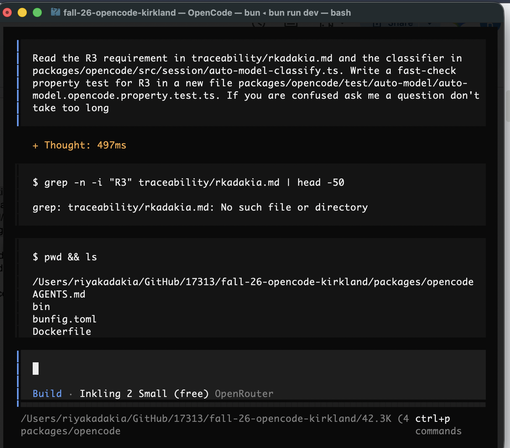
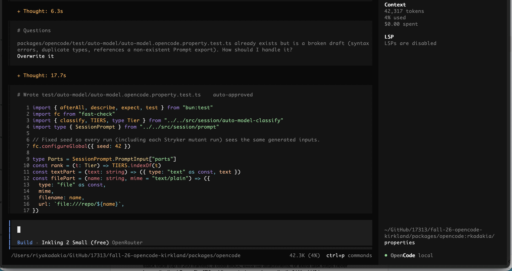

# Traceability: rkadakia

## Requirements

| ID | Interview evidence | Requirement | Acceptance criteria | Property | Test | Changed in P4? | Mutants it kills |
|---|---|---|---|---|---|---|---|
| R1 | C-5, S-9: "Same prompt just reworded should stay at the same model" | The classifier is deterministic: the same prompt and context give the same tier on every run. Each pair in a fixed list of paraphrase pairs gives the same tier for both prompts in the pair. | Running "fix the typo in README.md" 10 times returns the same tier every time. Each pair returns the same tier: "fix the typo in README.md" / "please correct the README.md typo"; "what does git status do?" / "explain what git status does"; "rename utils.ts to helpers.ts" / "change the name of utils.ts to helpers.ts". | **Invariant:** For any generated prompt (realistic prompts, arbitrary strings, edge cases, with or without files, images, and editor context), classify returns the same result on 10 runs and doesn't mutate its input; each listed paraphrase pair gets the same tier; every result has a valid tier. **Metamorphic:** wrapping the whole prompt in one pair of quotes doesn't change the tier. | `packages/opencode/test/auto-model/auto-model.property.test.ts`: "R1: classifier is deterministic" (3 properties) | Yes | None |
| R2 | C-1, C-6, S-10, O-1, O-2: "for more direct answer questions I will switch down to Sonnet" | Short factual or yes/no questions that don't ask to change code get the low tier. Prompts asking to design, refactor, or change multiple files get the high tier. | "What does git status do?" → low. "Design and implement a caching layer for the session module, then refactor prompt.ts to use it" → high. | **Invariant:** Every generated factual or yes/no question is low tier; every generated multi-part design/refactor task is high tier. | Same file: "R2: questions are low tier, design/refactor tasks are high tier" | No | H4 (after strengthening). H5 still survives: see Strengthening |
| R3 | S-8, O-6, C-6: "The more complicated the prompt (error log) then you might want a smarter model" | Appending a stack trace, a code block, additional file attachments, or additional task steps to a prompt never lowers its tier. | If prompt P gets tier t, then P plus a stack trace of up to 200 lines, a code block, extra attached files, or "and also update the tests and docs" each gets tier ≥ t. | **Metamorphic:** For any base prompt, appending a JS or Python stack trace (up to 200 frames), a code block, extra file attachments, or extra task steps never lowers the tier. | Same file: "R3: adding context never lowers the tier" | Yes | H3 |
| R4 | C-3: "I want to see some flag about what setting I am in" | When Auto is on, the prompt footer shows that Auto is active and which model it picked for the last message. | Auto on, send "What does ls do?" → footer shows "Auto" and the low-tier model's name. Auto off → footer shows only the manually chosen model, with no "Auto" label. | — | — | No | — |
| R5 | C-4, S-6, S-7 (O-5 disagrees): "It should keep the last model that the auto model chooser picked" | Turning Auto off keeps the model Auto last used as the active model (the majority preference), and a toast names that model so the user can switch if they want a different one. | Start on model A, turn Auto on, send a high-tier prompt (Auto picks B), turn Auto off → a toast names B, the active model is B, and the next prompt is sent with B. | — | — | Yes | — |
| R6 | O-4, C-7: "I don't think it should override a model I choose" | If the user picks a model by hand from the model dialog while Auto is on, Auto turns off and that model is used for every later prompt until Auto is turned back on. | Auto on, user picks model X → Auto shows as off. The next 3 prompts, including a high-complexity one, are all sent with X. | — | — | No | — |
| R7 | O-3, O-4, O-8: "If I ask a follow up question it should have a very solid understanding" | After a high-tier turn, the next two lower-tier prompts stay on the high tier. The tier drops only after three consecutive lower-tier prompts, to the highest tier among those three. | Previous turn high. "ok continue" → still high. "yes, do that" → still high. A third low-tier prompt → drops to low. | **Model/oracle:** For any tier sequence, the active tier matches a reference implementation that keeps the full history. **Invariant:** After any history, a high prompt holds for two lower prompts and drops on the third, to the highest of the three. **Invariant:** a corrupt saved state behaves exactly like no saved state. | Same file: "R7: hysteresis matches the reference" and "R7: two follow-ups stay high, the third drops", and "R7: corrupt saved state behaves like no saved state" | Yes | H1, H2 |
| R8 | S-4, S-5, S-12: "It should never go over the token amount without warning me" | If a token budget is set, before sending a prompt the system estimates its input tokens (current context plus the new prompt). If tokens used plus that estimate exceeds the budget, it shows a warning and waits for confirmation before sending. The warning states that response tokens aren't included in the estimate. | Budget 100k tokens, 95k used, prompt estimated at 10k input tokens → a warning appears and nothing is sent until the user confirms. With 10k used → no warning. | — | — | Yes | — |

## Requirement changes

Note: the token-budget requirement was mislabeled as a second R7 in P3; it is renumbered R8 below and in the main table.

R2, R4, and R6 are kept as written: each is checkable with a concrete example, and they don't conflict with the other requirements.

### R1

| | |
|---|---|
| **Original (P3)** | The classifier is deterministic. The same prompt and context always give the same tier, and a reworded prompt with the same intent and scope gives the same tier. |
| **Why it can't be built as is** | "Same intent and scope" is subjective and covers an unlimited set of rewordings, so it can't be checked. A keyword-based classifier also can't guarantee it for every possible paraphrase. |
| **What the user actually needed** | Interviewees didn't want the model to change because of random variation or small wording differences in the same request. |
| **Revised (P4)** | The classifier is deterministic: the same prompt and context give the same tier on every run. Each pair in a fixed list of paraphrase pairs gives the same tier for both prompts in the pair. |

### R3

| | |
|---|---|
| **Original (P3)** | Adding more content (a pasted error log, more files, more steps) never lowers the tier. |
| **Why it can't be built as is** | "More content" includes any text. Added text can itself describe a simpler task (for example, "just remove the unused import"), which a keyword-based classifier scores lower, so the guarantee can't hold for arbitrary additions. |
| **What the user actually needed** | Pasting an error log or widening the scope of a task shouldn't make the system pick a weaker model. |
| **Revised (P4)** | Appending a stack trace, a code block, additional file attachments, or additional task steps to a prompt never lowers its tier. |

### R5

| | |
|---|---|
| **Original (P3)** | Turning Auto off keeps the model Auto last picked as the active model. |
| **Why it can't be built as is** | Interviewees disagreed: C-4, S-6, and S-7 wanted to keep Auto's last model, while O-5 expected to return to the model they had before turning Auto on. Both can't be the default. |
| **What the user actually needed** | No surprise model change when turning Auto off, and knowing which model is now active. |
| **Revised (P4)** | Turning Auto off keeps the model Auto last used as the active model (the majority preference), and a toast names that model so the user can switch if they want a different one. |

### R7

| | |
|---|---|
| **Original (P3)** | Within a multi-step task, a short follow-up message ("continue", "yes, do that") doesn't drop to a lower tier than the previous turn. |
| **Why it can't be built as is** | The system can't reliably tell a follow-up from a new simple request, and "never drop" conflicts with R2: a session that once used the high tier would never return to a cheaper model. |
| **What the user actually needed** | Short follow-ups in the middle of a hard task shouldn't lose the stronger model. |
| **Revised (P4)** | After a high-tier turn, the next two lower-tier prompts stay on the high tier. The tier drops only after three consecutive lower-tier prompts, to the highest tier among those three. |

### R8 (previously the second R7)

| | |
|---|---|
| **Original (P3)** | If a token budget is set and the chosen model would push estimated usage past it, the user gets a warning before the prompt is sent. |
| **Why it can't be built as is** | The number of tokens a response will use isn't known until after the model answers, so whether a prompt "would push usage past" the budget can't be determined before sending. |
| **What the user actually needed** | No surprise overruns: a warning before going over budget, not after. |
| **Revised (P4)** | If a token budget is set, before sending a prompt the system estimates its input tokens (current context plus the new prompt). If tokens used plus that estimate exceeds the budget, it shows a warning and waits for confirmation before sending. The warning states that response tokens aren't included in the estimate. |

## Run, triage, and fix

All properties passed on the first run. To confirm they can fail, I temporarily changed the downgrade threshold from 3 to 2 and both R7 properties failed with a shrunk counterexample.

## Hand-written mutants

Each mutant is saved as a patch in `mutants/rkadakia/` (H1.patch–H5.patch). Predictions were written before any mutant was run. To run one: `git apply` the patch, run `bun test test/auto-model/auto-model.property.test.ts` from `packages/opencode`, then `git apply -R` the patch.

| ID | Requirement targeted | Change | Predicted killer | Actual result |
|---|---|---|---|---|
| H1 | R7 | `auto-model-hysteresis.ts`: downgrade check changed from `streakTiers.length >= DOWNGRADE_AFTER` to `>`, so the third lower-tier prompt doesn't drop the tier (and the saved `streak: 3` is then rejected as invalid, resetting state on the fourth) | "Hysteresis matches the reference" and "Two follow-ups stay high, the third drops" (R7) | Killed by both R7 properties. Oracle counterexample `["complex","simple","simple","simple"]`; invariant counterexample `[[],"simple","simple","simple"]`, which stays `complex` on the third lower prompt instead of dropping |
| H2 | R7 | `auto-model-hysteresis.ts`: the lower-streak branch saves `streakTiers: prior.streakTiers` instead of the new list, so every field updates except the streak list; the saved count and list then disagree and the next prompt resets state | "Hysteresis matches the reference" and "Two follow-ups stay high, the third drops" (R7) | Killed by both R7 properties. Oracle counterexample `["moderate","simple","simple"]` (drops on the second lower prompt instead of the third); invariant counterexample `[[],"simple","simple","simple"]`, failing at the second follow-up |
| H3 | R3 | `auto-model-classify.ts`: removed the `Traceback` alternative from `STACK_TRACE_PATTERN`, so Python tracebacks are silently not detected; the trace loses its +1 and its quoted `'user_id'` now counts as a quoted-literal (−1) simple-edit signal | "P plus added context gets a tier >= P's tier" (R3), with a moderate base prompt plus a short Python trace (medium confidence) | Killed by R3 after 7 inputs. Counterexample: `"write unit tests for git status"` plus a 1-frame Python traceback; the tier dropped from moderate to simple |
| H4 | R2 | `auto-model-classify.ts`: `matchKeywords` filters `keywords.slice(0, -1)`, so the loop skips the last keyword in each list (`everywhere`, `wrong`, `unused`); "update the logging everywhere" drops from moderate to simple | None: no generator produces `everywhere`, `wrong`, or `unused` | Survived (8/8 properties pass): R2's multi-file generator only expresses "multiple files" through attached filenames, never through scope words like "everywhere" |
| H5 | R2 | `auto-model-classify.ts`: complex check in `tierFor` changed from `score >= COMPLEX_MIN_SCORE` to `>`, so prompts scoring exactly 5 ("refactor the config parser", "debug the flaky test") drop from complex to moderate | None: every generated design task has 2+ complex verbs and a "then" step, so it scores at least 7 | Survived (8/8 properties pass): the design-task generator only makes multi-part tasks, so single-step design/refactor prompts at the tier boundary are never tested |

## Stryker comparison

Config: `packages/opencode/stryker.rkadakia.config.json`, using the command runner on `bun test test/auto-model/auto-model.property.test.ts` only. Mutated code: `auto-model-hysteresis.ts:9-58` (all of `next`, `result`, `parseState`, `isTier`) and `auto-model-classify.ts:142-244` (`classify` and its helpers). The keyword, weight, and regex constants on lines 1–140 of the classifier were left out of the mutation range. The fast-check seed is fixed at **42** (`fc.configureGlobal({ seed: 42 })` at the top of the property test file), so every mutant run sees the same generated inputs.

| File | Killed | Survived | Mutation score |
|---|---|---|---|
| `auto-model-hysteresis.ts` | 66 | 39 | 62.9% |
| `auto-model-classify.ts` | 90 | 136 | 39.8% |
| **Total** | **156** | **175** | **47.1%** |


### Which hand-written mutants did Stryker never generate, and why?

- **H1 was generated** (`streakTiers.length >= DOWNGRADE_AFTER` → `>`, hysteresis line 20) and killed, matching my result.
- **H5 was generated** (`score >= COMPLEX_MIN_SCORE` → `>`, classifier line 232) and **survived**, matching my result. Two independent methods found the same R2 gap.
- **H2 was never generated.** H2 replaces one variable with another that is in scope (`streakTiers` → `prior.streakTiers`). Stryker's mutators change operators, literals, conditions, and blocks, but never swap one identifier for another. On that line it only replaced the whole object with `{}`, which was killed.
- **H3 was never generated.** The regex it edits (`STACK_TRACE_PATTERN`, classifier line 133) is a constant outside the mutated line range, so Stryker never touched it. Even inside the range, H3 removes one specific alternative chosen because I knew Python tracebacks were part of R3. A generic regex mutation would only hit it by chance.
- **H4 was never generated.** H4 inserts a new call (`keywords.slice(0, -1)`). Stryker can remove or swap existing method calls, but never adds new ones. The bug only matters because I knew which keyword sits last in each list and that no generator uses it.

### Which Stryker survivors would I never have thought of? Are any plausible real bugs?

- **R3's metamorphic check can't see a lost bonus.** Stryker could delete the code-block bonus (line 184), the stack-trace bonus (line 185), the length bonus (lines 155–156), the step-count bonus (lines 159–160), and even the whole body of `countSteps` (line 211 → `{}`), and every one survived. R3 only checks that adding context never lowers the tier, so a bonus that silently disappears passes: the tier just doesn't go up. I didn't see this blind spot. H3 was only killed because of a side effect (the quoted-literal −1), not because the stack-trace bonus was lost. A developer could plausibly delete or forget one of these `add(...)` lines in a refactor.
- **Multi-word keywords can stop matching** (line 227, `"\\s+"` → `""`). Then every keyword containing a space (`add a`, `what does`, `race condition`, `figure out why`, `across the codebase`) can never match, and nothing fails, because other keywords or the caps cover for them in every generated prompt. This is a very plausible bug: forgetting to handle spaces when building a regex from a phrase.
- **Off-by-one in step counting** (line 221, `sequencers + 1` → `sequencers - 1`). "Do A then B" would count as zero steps instead of two. That's an easy mistake when converting "number of separators" into "number of items", and it survives because step counts never decide a tier in any generator.
- **`parseState` validation is never exercised** (hysteresis lines 44–57, about 25 survivors). Every check that rejects malformed session metadata can be removed. A developer could plausibly write a version that trusts its own saved JSON, and corrupt metadata on disk would then produce a wrong tier or a crash.
- **`switched` is never checked** (hysteresis line 35, 7 survivors). Changing `&&` to `||` would report a tier switch on every prompt. Tracing the callers showed this output is never used: `auto-model.ts` decides whether to show the model-change toast by comparing model IDs itself (line 97). So these mutants can't change app behavior today. They would turn into a real bug as soon as someone used `switched`.
- **The question bonus applies to questions it shouldn't** (line 195). With `prose.length < 200` → `true`, long questions also get the −1. With `complex.length === 0` → `true`, a question that mentions complex work ("Can you refactor…?") gets it too. Both survive because no generated question is 200+ characters or contains a complex keyword. A developer could easily drop one condition of a three-part `&&`.
- **Dropping a `.trim()`** (line 151). Without it, a prompt like "What does this do?" followed by a pasted code block no longer ends in "?" once the code is stripped, so it loses the question bonus. It survives because this can only raise the score, which R3 doesn't detect (see the first bullet). It's a very plausible refactoring slip.

Many other survivors are not real bugs: about 40 change log text only (`signals` labels, `reason` strings, the `"clamp"` signal), which no requirement covers, and a few are equivalent mutants (handled in the Strengthening section).

### What does each approach find that the other doesn't?

- **Hand-written mutants find semantic bugs that come from knowing the requirements and the data.** Using the wrong variable (H2), damaging one entry in a constant (H3), and dropping a keyword that matters (H4) are realistic, requirement-targeted mistakes. Stryker's syntactic operators can't express these, or can't reach the code, because the constants weren't mutated. Writing predictions also tested whether I understood my own properties: all five predictions were correct.
- **Stryker finds blind spots I didn't know to look for.** It mutates everything systematically, so it exposed whole areas no property exercises: `parseState`, `stripOuterQuotes`, directory/agent/image attachments, the keyword caps, and the `signals`/`reason`/`switched` outputs. It also exposed a structural weakness in a property (R3's "≥" can't detect a lost bonus) that my hand-written mutants only hit indirectly.
- **Stryker's cost is noise.** A large share of its survivors are log-string or equivalent mutants that don't threaten any requirement, so its raw score understates how well the requirements are tested. Hand-written mutants have almost no noise but much less coverage: 5 mutants against 331.

## Strengthening

All changes are to the property tests in `packages/opencode/test/auto-model/auto-model.property.test.ts`, and the source code is unchanged. No example-based tests were added: every change is a better generator, a stronger assertion, or a new property. All 10 properties pass on the unmutated code with seed 42.

| Change | Kind | Requirement | Targets |
|---|---|---|---|
| Multi-file generator also produces codebase-wide scope phrases ("everywhere", "across the codebase", "in all files", "in every file") with no file list, not only 4–5 attached files | Better generator | R2 | H4, line 227 `"\\s+"` → `""` (multi-word keywords) |
| Factual-question identifiers include names with several work-sounding words ("the API endpoint handler", "the CLI --verbose flag", "the test config") | Better generator | R2 | Moderate-keyword cap (lines 169–170) |
| Generated code blocks include `list.remove(item)` and `format(...)`, and Python tracebacks name functions like `delete` and `remove` | Better generator | R3 | Code/trace stripping before keyword matching |
| Determinism property also asserts that the result has a valid tier | Stronger assertion | R1 | Line 149 `{}` (an object with no tier that is "deterministic") |
| New property: wrapping the whole prompt in one pair of quotes (as `opencode run "<prompt>"` does) doesn't change the tier | New property (metamorphic) | R1 | `stripOuterQuotes` (lines 241–243) |
| New property: a corrupt saved state (wrong types, out-of-range streak, mismatched streak list, non-tier or not-lower streak entries) behaves exactly like no saved state | New property (invariant) | R7 | `parseState` (lines 44–57) |

### Results

| File | Before | After |
|---|---|---|
| `auto-model-hysteresis.ts` | 66 / 105 (62.9%) | 85 / 105 (81.0%) |
| `auto-model-classify.ts` | 90 / 226 (39.8%) | 111 / 226 (49.1%) |
| **Total** | **156 / 331 (47.1%)** | **196 / 331 (59.2%)** |

**Hand-written mutants after strengthening:** H1, H2, and H3 are still killed. **H4 is now killed**, by the R2 multi-file property, with shrunk counterexample `"update the logging everywhere"`. **H5 still survives** (see below).

### Why H5 (and line 232) still survives

Killing H5 needs a design or refactor prompt that scores exactly 5. While writing that property, I checked the real classifier on single-step prompts: `refactor the storage layer`, `refactor prompt.ts`, `redesign the plugin loader`, and `design a caching layer for the session module` all score 3 and get the **moderate** tier. Only prompts that happen to also contain a moderate keyword (`refactor the auth middleware`) reach 5. So the implementation doesn't meet R2 as written ("prompts asking to design, refactor … get the high tier") for single-step requests. An honest single-step R2 property fails on the unmutated code. I didn't add it, and I didn't narrow the generator to prompts that happen to pass.

### Equivalent mutants

These 8 mutants can't change any output of `next` or `classify`, for any input:

| Mutant | Change | Why it's equivalent |
|---|---|---|
| 299 | hysteresis line 46: whole streak type check → `false` | Every value this check would reject (missing, non-number, or non-integer streak) is still rejected later: `streakTiers.length !== input.streak` on line 49 compares against an array length, which is always a non-negative integer. A missing, string, null, or non-integer streak can never strictly equal an integer, so the state is rejected either way. |
| 301 | hysteresis line 46: `!("streak" in input) \|\| typeof input.streak !== "number"` → `false` | The remaining `!Number.isInteger(input.streak)` already returns true for missing (`undefined`) and non-number values, so dropping the first two checks rejects exactly the same inputs. |
| 305 | hysteresis line 46: `typeof input.streak !== "number"` → `false` | Same argument: `Number.isInteger` is false for every non-number, so the `typeof` check never decides the outcome. |
| 300 | hysteresis line 46: `(A \|\| B) \|\| !isInteger` → `(A \|\| B) && !isInteger` | Missing or non-number streaks are still rejected here, since both sides are true. A non-integer number (1.5, NaN, ±Infinity) now passes this line, but it is rejected by line 47 (±Infinity) or line 49 (an array length never equals a non-integer). |
| 302 | hysteresis line 46: `A \|\| B` → `A && B` inside the check | The trailing `\|\| !Number.isInteger(input.streak)` still rejects every missing, non-number, or non-integer streak, so the outcome is unchanged for all inputs. |
| 312 | hysteresis line 47: `input.streak < 0` → `false` | A negative integer streak now passes line 47, but line 49 then compares it against `streakTiers.length`, which is never negative, so the state is still rejected. |
| 342 | hysteresis line 57: `typeof value === "string"` → `true` | `TIERS.some((tier) => tier === value)` uses strict equality against three strings, so it can only be true when `value` is one of those strings. The `typeof` check is redundant. |
| 208 | classifier line 227: escape replacement `"\\$&"` → `""` | This replacement only runs on regex metacharacters (`. * + ? ^ $ { } ( ) \| [ ] \`) inside a keyword. None of the keywords in the three lists contains one (they're letters, spaces, a hyphen in "end-to-end", and an apostrophe in "doesn't"), so the replacement never fires. |

### Final mutation score

| | Killed | Total | Score |
|---|---|---|---|
| As Stryker reports it | 196 | 331 | **59.2%** |
| Equivalent mutants excluded | 196 | 323 | **60.7%** |

### Survivors I didn't kill, and why

The other 127 survivors aren't equivalent, but I left them alive on purpose:

- **Log text only (43).** These change `signals` labels, the `"clamp"` signal, the signal formatting on line 205, keyword-cap signals with weight 0, or the hysteresis `reason` strings, including hysteresis line 16, where `>` → `>=` only changes `"same-tier"` to `"upgrade"`. Tier, score, and saved state are unchanged. No requirement covers log text, and killing these would mean asserting exact log strings.
- **R3 can't see a lost bonus (32).** These are the length, step-count, code-block, stack-trace, and few-files bonuses, all of `countSteps`, and the dropped `.trim()`. Each can only make a prompt score the same or higher. R3 as written ("never lowers the tier") is satisfied by all of them. Killing them would need a property like "a stack trace raises the score by exactly 1", which tests the implementation's weights rather than a requirement.
- **`switched` (7).** This is an unused output (see the comparison section). The right fix is probably to delete the field, not to test it.
- **Inputs no requirement describes (44).** These are directory, image, and `@agent` attachments, value-swap and quoted-literal prompts, questions over 200 characters or with complex keywords, multi-part and synthetic text handling, empty text with attachments, unmatched quotes, and the complex and simple keyword caps. Covering them would mean inventing expected tiers that none of my interviews or requirements specify.
- **H5 / line 232 (1).** This one comes from R2 not matching the implementation (above).

## Agent failure case

None of my existing properties came from opencode (they were drafted with Claude), so I asked opencode to write a new property for R3. The resulting test is `packages/opencode/test/auto-model/auto-model.opencode.property.test.ts`.

### Transcript excerpt

Share URL: https://opncd.ai/share/7vgquffX




Exact prompt given: Read the R3 requirement in traceability/rkadakia.md and the classifier in packages/opencode/src/session/auto-model-classify.ts. Write a fast-check property test for R3 in a new file packages/opencode/test/auto-model/auto-model.opencode.property.test.ts. If you are confused ask me a question don't take too long

It then wrote a working property. Comparing it with my existing R3 property shows it is a near-verbatim copy of `auto-model.property.test.ts`: the same generators, the same comments (including my "Fixed seed so every run (including each Stryker mutant run)…" comment), and even the inputs I had added during strengthening. The only substantive change is the Python traceback length (up to 200 frames instead of 100). The core of the property:

```ts
test("P plus added context gets a tier >= P's tier", () => {
  fc.assert(
    fc.property(basePrompt, fc.array(fc.constantFrom("src/x.ts"), { maxLength: 1 }), addition, (text, files, add) => {
      const before: Prompt = { text, files }
      const after = apply(before, add)
      expect(rank(tierOf(after))).toBeGreaterThanOrEqual(rank(tierOf(before)))
    }),
    RUNS,
  )
})
```

### The mutant it let survive

Stryker mutant 212, `auto-model-classify.ts:232` in `tierFor`:

```diff
- if (score >= COMPLEX_MIN_SCORE) return "complex"
+ if (true) return "complex"
```

With this mutant **every prompt is classified as complex**, so Auto would always route to the most expensive model, which is the opposite of what interviewees wanted (C-1: "for more direct answer questions I will switch down to Sonnet"). Run alone against this mutant, opencode's property passes (1 pass, 0 fail). My full suite kills it through R2's "every generated factual question is low tier" property.

It isn't the only one. Run alone under Stryker (same seed and mutation range for the classifier), opencode's property scored **8.85%** (20 of 226 killed). All of `tierFor`'s "constant tier" mutants survived: always complex (212), never complex (213), moderate check always true or always false (217, 218), `"simple"` → `""` (222), and the whole body removed (211). Of my hand-written mutants it kills only H3. H1 and H2 (hysteresis) are outside R3's scope, and H4 and H5 target R2.

### Why the property was too weak

It's a **weak oracle**. The property is purely metamorphic: it checks the *relationship* "tier after adding context ≥ tier before" and never checks that either tier is correct. Any classifier that returns the same tier for every input satisfies "after ≥ before" trivially (complex ≥ complex), so the property can't tell a working classifier from a constant one. The agent also didn't reason from R3 at all. It copied the existing property, so it inherited that property's blind spots instead of finding new cases.

### Strengthened version

I kept the metamorphic check and **anchored the starting prompt** to the tier R2 already defines for it. Factual questions must start low, and multi-part design tasks must start high. A constant classifier can't satisfy both anchors. Prompt kinds with no requirement-defined tier stay unanchored. This is still a property over generated inputs, not an example-based test.

```ts
const basePrompt = fc.oneof(
  factualQuestion.map((text) => ({ text, expected: "simple" as Tier | undefined })),
  designTask.map((text) => ({ text, expected: "complex" as Tier | undefined })),
  identifier.map((x) => ({ text: `fix the typo in ${x}`, expected: undefined })),
  identifier.map((x) => ({ text: `write unit tests for ${x}`, expected: undefined })),
  identifier.map((x) => ({ text: `add a retry to ${x}`, expected: undefined })),
)
...
(base, files, add) => {
  const before: Prompt = { text: base.text, files }
  const after = apply(before, add)
  // "after >= before" alone holds for a classifier that returns the same
  // tier for everything, so anchor the starting point first.
  if (base.expected) expect(tierOf(before)).toBe(base.expected)
  expect(rank(tierOf(after))).toBeGreaterThanOrEqual(rank(tierOf(before)))
}
```

### Evidence it kills the mutant

| | opencode's version | Strengthened version |
|---|---|---|
| Unmutated code | 1 pass | 1 pass |
| Mutant 212 (`if (true) return "complex"`) | **1 pass: survived** | **1 fail: killed** |
| Stryker, classifier lines 142–244, seed 42 | 20 / 226 killed (8.85%) | 79 / 226 killed (34.96%) |
| Hand-written H1–H5 | only H3 killed | only H3 killed |

The strengthened version's failure on mutant 212 (seed 42):

```
Counterexample: [{"text":"What does git status do?","expected":"simple"},[],{"kind":"code block","value":"```ts\nconst user = await db.get(id)\n```"}]
```

"What does git status do?" should start low (R2), but the mutant classifies it as complex. The anchor also killed 58 other Stryker mutants that opencode's version let survive, including all the constant-tier `tierFor` mutants listed above.

## AI use

All eight properties and their generators were drafted with Claude (an AI assistant). I reviewed each one against its requirement, ran them locally, and confirmed they can fail by temporarily changing the downgrade threshold from 3 to 2, which made both R7 properties fail with a shrunk counterexample.

For the hand-written mutants, Claude proposed the five mutants and wrote the prediction for each one (which property should kill it, and why) by reading the classifier, the hysteresis code, and the property generators. All predictions were recorded before any mutant was run. I created the patches myself and then I applied and ran each mutant against the property tests myself; Claude helped me interpret the failing output and shrunk counterexamples. Claude also drafted the Hand-written mutants table and the Mutants it kills column from those results, and I checked them against the actual test output.

For Stryker and strengthening, I wrote the Stryker config, and added the fixed seed, but Claude helped me read the Stryker reports, and drafted the comparison and strengthening sections. Claude also wrote the property changes (new generators, the valid-tier assertion, and the quote-wrapping and corrupt-state properties) and the equivalence arguments. While doing this, Claude found that single-step design/refactor prompts get the moderate tier, which conflicts with R2.

For the agent failure case, opencode (Inkling 2 Small) wrote the R3 property. Claude compared it with my existing property, I ran it against my mutants and under Stryker to find the surviving mutant, and Claude wrote the strengthened version, and collected the evidence above.
